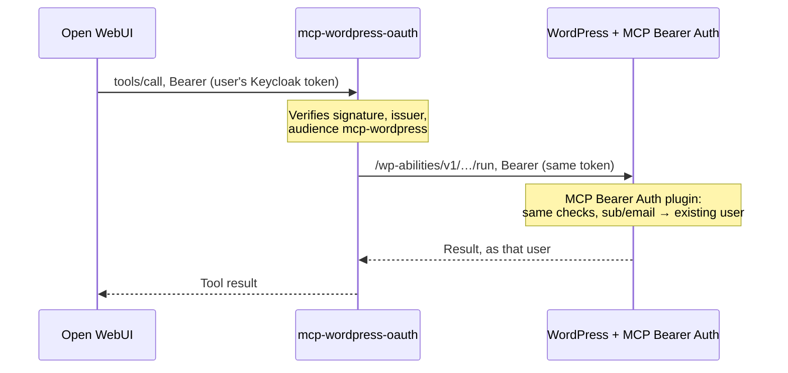

# mcp-wordpress-oauth

An MCP server that gives an AI assistant a WordPress site's **Abilities** as
tools, one tool per ability, and runs every call **as the signed-in WordPress
user**, with that user's own permissions. It needs no admin or service
account.

It needs WordPress 6.9+ (Abilities API). Abilities come from plugins such as
[Enable Abilities for MCP](https://wordpress.org/plugins/enable-abilities-for-mcp/),
and admins switch them on and off in WordPress.

## Three ways to sign in (`AUTH_MODE`)

| Mode | For | Users sign in with | Server stores |
|---|---|---|---|
| `resource` (default) | Open WebUI + Keycloak | their Keycloak SSO login, forwarded by Open WebUI | nothing |
| `proxy` | MCP clients that need the MCP OAuth flow (DCR) + Keycloak | Keycloak, via this server | client registrations, sessions |
| `wordpress` | claude.ai, ChatGPT, Claude Code; no Keycloak | their WordPress account (Application Password) | encrypted Application Passwords, sessions |

### `resource`: one Keycloak token end to end



This mode needs a WordPress plugin that accepts the token. This repository
ships one: **[MCP Bearer Auth](wordpress-plugin/mcp-bearer-auth/README.md)**.
It works alongside any OIDC login plugin. Install the `mcp-bearer-auth.zip`
from a release, then set the following in `wp-config.php`:

```php
define( 'MCP_BEARER_ISSUER', 'https://sso.example.com/realms/main' );  // = OIDC_ISSUER
define( 'MCP_BEARER_USER_MATCH', 'meta:_sso_oidc_subject' );            // or: email, login
```

`MCP_BEARER_USER_MATCH` sets how a token finds its WordPress user:
- `meta:<key>`: the user meta key in which your login plugin stores the SSO
  subject. sso-login-oidc uses `_sso_oidc_subject`; OpenID Connect Generic
  uses `openid-connect-generic-subject-identity`.
- `email`: the token's verified email address.
- `login`: the token's `preferred_username` claim.

Other details:
- Keycloak tokens need `mcp-wordpress` in `aud`. Add an audience mapper, and
  keep the same value in `MCP_AUDIENCE` here and in `MCP_BEARER_AUDIENCE`.
- Any other plugin that accepts such bearer tokens on the Abilities routes
  works too. One example is sso-login-oidc's own bearer feature.

### `wordpress`: this server is the OAuth server

```mermaid
sequenceDiagram
    actor U as User
    participant C as claude.ai / ChatGPT
    participant MCP as mcp-wordpress-oauth
    participant WP as WordPress

    C->>MCP: /authorize (CIMD or registered client)
    MCP->>U: Consent screen
    U->>WP: authorize-application.php: log in, approve "MCP"
    WP->>MCP: /wp/callback with a new Application Password
    Note over MCP: Checks consent cookie, site, password;<br/>stores it encrypted
    MCP->>C: code → access + refresh token
    C->>MCP: tools/call
    MCP->>WP: run ability, Basic auth (user's Application Password)
```

- **claude.ai:** Settings > Connectors > Add custom connector, with
  `https://<BASE_URL>/mcp`. Claude identifies itself by its client metadata
  URL, which is in `OAUTH_CIMD_ALLOWLIST` by default.
- **ChatGPT:** needs Dynamic Client Registration. Set `OAUTH_DCR_ENABLED=on`.
  Its callback URLs are in `OAUTH_REDIRECT_ALLOWLIST` by default.
- Users find the connection in their WordPress profile under *Application
  Passwords* (named `OAUTH_APP_NAME`). Revoking it there ends the MCP
  session within `WP_CREDENTIAL_RECHECK` seconds.
- WordPress only creates Application Passwords over HTTPS. Both the site
  and `BASE_URL` must be HTTPS.

## Run

```bash
cp .env.example .env    # set BASE_URL, WORDPRESS_URL, AUTH_MODE and its settings
docker compose up -d
```

Put a TLS reverse proxy in front. In `wordpress` mode, it must **not log query
strings** for `/wp/callback`: WordPress sends the new Application Password
there (docs/decisions.md, D8). The server's own access log is off.

The MCP endpoint is `BASE_URL + /mcp`. On startup, the server logs the
client settings to use. `GET /healthz` needs no token.

## Tools

- `whoami`: which WordPress user you act as, your roles, and how many
  abilities you have as tools.
- One tool per ability that WordPress lists for you, for example
  `core-get-site-info` for `core/get-site-info`. Tools use the ability's label,
  description, JSON schemas and annotations (read-only, destructive,
  idempotent). Which abilities qualify:
  - `ABILITY_MCP_PUBLIC_ONLY=on` (default): only abilities flagged
    `meta.mcp.public`, like WordPress' MCP Adapter.
  - `ABILITY_ALLOW` / `ABILITY_DENY`: globs such as `core/*,ewpa/*`; deny wins.

## Development

```bash
python3 -m venv .venv && .venv/bin/pip install -e ".[dev]"
.venv/bin/pytest
```

The unit and HTTP tests need neither Keycloak nor WordPress. The WordPress
plugin has its own tests: run `composer install && composer test` in
`wordpress-plugin/mcp-bearer-auth`. The end-to-end stack, with real
WordPress, Keycloak and the plugin, is in `test-stack/` (Docker).

Why things are the way they are: [docs/decisions.md](docs/decisions.md).
