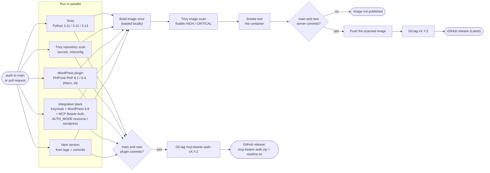

# CI, versioning and releases

`.github/workflows/ci.yml` runs on every pull request and every push to `main`
(docs-only changes are skipped).

**An image is published only if all of these pass:** the full test suite on
three Python versions, Trivy's repository scan, the end-to-end checks against
the test stack in both `AUTH_MODE=resource` and `AUTH_MODE=wordpress`
([test-stack/README.md](../test-stack/README.md)), Trivy's image scan, and a
smoke test of the built container in both modes (`/healthz`, 401 with
`resource_metadata`, no `registration_endpoint` by default in `wordpress`
mode, uid 10001). The pushed image is byte-for-byte the one that was scanned
and smoke-tested: it is built once, loaded locally, then pushed, never
rebuilt (decisions.md D13).

## Versions

The server and the WordPress plugin have separate versions (D11). Git tags
are the only place each version lives:

| Component | Tags | Commits that count | Published as |
|---|---|---|---|
| server | `vX.Y.Z` | everything outside `wordpress-plugin/mcp-bearer-auth/` | container image + GitHub release (marked Latest) |
| plugin | `mcp-bearer-auth-vX.Y.Z` | inside `wordpress-plugin/mcp-bearer-auth/` | GitHub release with `mcp-bearer-auth.zip` and `readme.txt`; sites update through WordPress (D14) |

A commit touching both releases both. On each push to `main`,
`scripts/next_version.py --component server|plugin` looks at that
component's commits since its last tag:

| Commit message | Bump | Example |
|---|---|---|
| `BREAKING CHANGE` in the body, or `type!:` subject | major (minor while 0.x) | `refactor!: rename OAUTH_* variables` |
| `feat:` / `feat(scope):` | minor | `feat(oauth): add CIMD allowlist` |
| anything else | patch | `fix: ...`, `chore: ...`, or any free text |

- First release ever: `v0.1.0` / `mcp-bearer-auth-v0.1.0`.
- **0.x → 1.0.0** is never automatic. Run the workflow manually (*Actions → CI
  → Run workflow*) with `bump: major` (server) or `plugin_bump: major`. The
  manual trigger also forces a patch/minor/major bump, e.g. to release a
  base-image security update without a code change.
- The tag is created **after** the image is pushed, so a failed run never
  burns a version number. Runs on `main` are serialized, so two pushes can't
  compute the same version.

Inside the image, `mcp_wordpress.__version__`, the startup log line, the MCP
`serverInfo.version` and the OCI label `org.opencontainers.image.version` all
carry the release version. Non-release builds (PRs) get
`<next>.dev0+g<sha>`, which can't be mistaken for a release.

Image tags per release `vX.Y.Z`: `X.Y.Z`, `X.Y`, `X` (from 1.0 on), `latest`, `sha-<commit>`.

## Security scans

| Scan | Scope | Fails on |
|---|---|---|
| repository (`trivy fs`) | committed secrets; Dockerfile/compose misconfiguration | HIGH, CRITICAL |
| image (`trivy image`) | OS packages and Python libraries in the image; secrets in layers | **fixable** HIGH, CRITICAL |

Unfixed CVEs don't block, since nothing could unblock them. The Dockerfile
applies pending Debian updates, so most base-image findings are fixed by
simply re-running the build.

**Accepting a finding:** add its ID to `.trivyignore` with a comment (why it
doesn't apply, who accepted it, when to review). That file is the audit
trail. Don't lower the severity threshold instead.

Trivy itself (binary version) and every action are pinned (actions by commit
SHA). Update them deliberately, in their own PR.

## Setup

**GitHub (default: ghcr.io).** Nothing to configure. The workflow pushes to
`ghcr.io/<owner>/<repo>` with the built-in token. New packages on ghcr.io
start private: set the visibility under *Packages → mcp-wordpress-oauth → Package
settings* if needed.

**Other registry** (repository *Settings → Variables / Secrets*):

| Kind | Name | Example |
|---|---|---|
| variable | `REGISTRY` | `registry.example.com` |
| variable | `IMAGE_NAME` | `team/mcp-wordpress-oauth` |
| variable | `REGISTRY_USERNAME` | `ci-bot` |
| secret | `REGISTRY_PASSWORD` | token with push rights |

**The WordPress plugin** (`wordpress-plugin/mcp-bearer-auth`) is tested in its
own job: PHPUnit on PHP 8.1 and 8.4, and phpcs (WordPress Coding Standards).
The same job builds `mcp-bearer-auth.zip`, which includes `vendor/` but no dev
dependencies or tests. Every run uploads it as an artifact, and releases attach
it. The integration stack builds the plugin from the same directory, so CI needs
no other repository.

The stack also needs internet access for `composer install` (the plugin's
dependencies) and wordpress.org ("Enable Abilities for MCP").

**Gitea Actions** runs this workflow too (it reads `.github/workflows`), with
the registry variables above pointing at Gitea's container registry. The
GitHub-release step is skipped there (`gh` targets GitHub only), and the
`vX.Y.Z` tag is still pushed. The build cache is best-effort, so an
unsupported cache backend doesn't fail the build. Your runner must provide
Docker (the smoke test runs the image) and resolve `uses:` against github.com.
