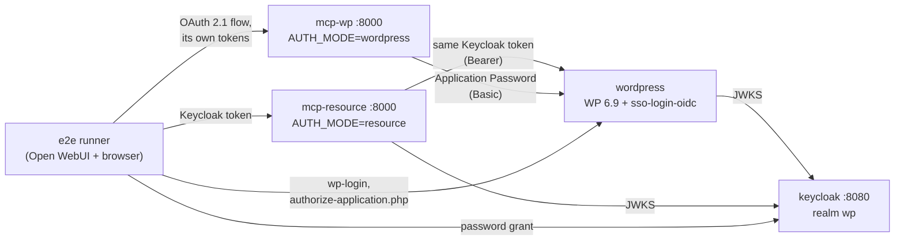

# Disposable test stack

Keycloak, WordPress 6.9 (with sso-login-oidc's bearer feature, "Enable
Abilities for MCP" and a set of test abilities) and this server in both
`AUTH_MODE=resource` and `AUTH_MODE=wordpress`, plus end-to-end checks of
both chains. Use it to try the setup, to compare against your own
configuration, or to reproduce a problem. CI runs the same checks before
every release.

```bash
docker compose -f test-stack/docker-compose.yml up -d --build
docker compose -f test-stack/docker-compose.yml run --rm e2e
docker compose -f test-stack/docker-compose.yml down -v          # removes everything
```

`run --rm e2e` also starts the stack if it isn't up yet. `E2E_MODE=resource`
or `E2E_MODE=wordpress` runs only one mode's checks (default: both).

**sso-login-oidc** comes from a checkout next to this repository
(`../wordpress-openid-connect-plugin`), or from `SSO_PLUGIN_DIR`:

```bash
SSO_PLUGIN_DIR=/path/to/sso-login-oidc docker compose -f test-stack/docker-compose.yml up -d --build
```

It needs the bearer token feature (`includes/Auth/Bearer_Auth.php`); the setup
stops with a clear error otherwise. The checkout is only read: service
`sso-plugin` copies it and runs `composer install` on the copy.



## What gets started

| Service | What it is |
|---|---|
| `init` | Writes the realm to import (`init/prepare.sh`) |
| `keycloak` | Keycloak 26, dev mode, realm `wp`: users `alice`, `bob`, `carol` (password = username, fixed ids); client `openwebui` with an audience mapper for `mcp-wordpress`; client `other` without one |
| `sso-plugin` | sso-login-oidc from `SSO_PLUGIN_DIR`, with `composer install --no-dev`, into a volume |
| `db` | MariaDB for WordPress |
| `wordpress` | `wordpress:6.9-apache`, `WP_ENVIRONMENT_TYPE=local` (Application Passwords and bearer auth over plain HTTP), the must-use plugin [`wordpress/e2e-abilities.php`](wordpress/e2e-abilities.php) |
| `wp-setup` | wp-cli: installs WordPress, users alice (administrator), bob (author), carol (editor), activates sso-login-oidc and "Enable Abilities for MCP", configures the provider and bearer auth, links alice and bob to their Keycloak subjects ([`wordpress/wp-setup.sh`](wordpress/wp-setup.sh), [`wordpress/provision.php`](wordpress/provision.php)) |
| `mcp-resource` | This server, `AUTH_MODE=resource`, built from the working tree |
| `mcp-wp` | This server, `AUTH_MODE=wordpress`, DCR on |
| `e2e` | [`e2e.py`](e2e.py), run on demand |

Containers talk to each other by service name, and those names are also the
URLs that appear in tokens (`iss` = `http://keycloak:8080/realms/wp`),
WordPress' site URL (`http://wordpress`) and the OAuth redirects
(`http://mcp-wp:8000/wp/callback`). The e2e runner plays the browser, so the
host doesn't need to resolve them. To click through by hand, map `keycloak`,
`wordpress` and `mcp-wp` to 127.0.0.1 in your hosts file and use the ports from
the compose file (8080, 8081, 8001).

`EAM=off` skips installing "Enable Abilities for MCP" (it needs internet
access from the wp-setup container); the checks only use the test abilities.

## The test abilities

Each returns `{method, input, user}`: the HTTP method WordPress' run
controller received, the input it saw, and the user it ran as.

| Ability | Annotations | Method | Input |
|---|---|---|---|
| `e2e/get-info` | readonly | GET | object (query string `input[a][b]=…`) |
| `e2e/update-note` | – | POST | object (JSON body) |
| `e2e/delete-note` | destructive, idempotent | DELETE | integer (`?input=7`) |
| `e2e/echo-text` | – | POST | string (wrapped as `{"input": …}` by the MCP tool) |
| `e2e/editor-only` | readonly | GET | none; runs only for `edit_others_posts` |
| `e2e/editor-tools` | readonly | GET | none; only *listed* for `edit_others_posts` |
| `e2e/not-public` | readonly | – | not `meta.mcp.public`, so never a tool |

## What the checks cover

In order; the first failure stops the run and names the failing link.

**`AUTH_MODE=resource`**

1. Keycloak issues alice, bob and carol tokens; alice's has `mcp-wordpress` in `aud`.
2. WordPress itself accepts alice's token on `/wp/v2/users/me` (bearer feature,
   `Authorization` header reaches PHP), ignores it on a route that isn't
   allowlisted (`/wp/v2/settings`: 401), and refuses a token from client
   `other` (no `mcp-wordpress` audience).
3. The MCP server: 401 with resource metadata without a token, 401 for the
   `other` token.
4. alice and bob get different tool lists (`e2e-editor-tools`), and
   `e2e-not-public` is never a tool.
5. `whoami` says alice, administrator.
6. The run controller's method rule and input encoding, against real
   WordPress: GET with a nested query string, POST with a JSON body (as bob),
   DELETE with a scalar, a wrapped string input.
7. bob running `e2e-editor-only` gets a tool error naming
   `rest_ability_cannot_execute`; alice may run it.
8. carol (no linked WordPress account) gets only `whoami`, and it explains
   the missing link.

**`AUTH_MODE=wordpress`**

1. Authorization server metadata: registration (DCR is on in the stack),
   revocation, CIMD. 401 without a token and for a Keycloak token.
2. DCR refuses a redirect URI outside the allowlist and accepts a loopback one.
3. bob logs in to WordPress, approves the consent screen, and **rejects** in
   `authorize-application.php`: the MCP client gets `error=access_denied`
   with its state.
4. alice does the same and **approves**: WordPress creates an Application
   Password and sends it to `/wp/callback`; the client gets a code, then
   access and refresh tokens.
5. With that token: the e2e tools, `whoami` as alice, a POST and a DELETE
   ability running as alice (Basic auth with the Application Password).
6. Refresh works.
7. `/revoke` deletes the Application Password in WordPress (Basic auth with
   it now fails), and both the access and the refresh token stop working.

## When something fails

```bash
docker compose -f test-stack/docker-compose.yml logs wp-setup wordpress mcp-resource mcp-wp
docker compose -f test-stack/docker-compose.yml exec wordpress tail -n 50 /var/www/html/wp-content/debug.log
```

`wp-setup` failing usually means the sso-login-oidc checkout has no bearer
feature, or wordpress.org wasn't reachable (`EAM=off`).
